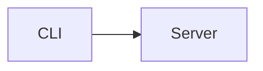

# encre format, version 2

This document is normative. `schema.json` is the machine-readable half of section 1. When this file and an implementation disagree, the implementation is wrong. The words MUST, MUST NOT and MAY are used in their RFC 2119 sense. It covers the format only: renderings such as Typst and PDF, the OpenUI adapter and the test vector files are described in `docs/`.

## 1. Document model

A document is a ProseMirror JSON tree that validates against `spec/schema.json`.

- The **stored form** is that JSON. A store keeps the schema version next to it.
- The **collaborative form** is a Yjs `XmlFragment` named `default`, in the layout `y-prosemirror` writes.
- **Markdown is a projection.** Facile Markdown (section 2) is lossless. CommonMark export (section 3) is lossy.

### 1.1 Nodes and marks

`schema.json` lists every node with `name`, `group`, `content` (a ProseMirror content expression), `marks` (the marks its inline content may carry: `_` all, empty none) and `attrs`. Marks are listed in rank order: the order a text node's `marks` array MUST follow.

| Node | Group | Content | Attributes |
|---|---|---|---|
| `doc` | | `block+` | |
| `paragraph` | block | `inline*` | `id` |
| `heading` | block | `inline*` | `id`, `level` 1, 2 or 3 |
| `bulletList` | block list | `listItem+` | `id` |
| `orderedList` | block list | `listItem+` | `id`, `start` 0 to 999999999, default 1 |
| `taskList` | block list | `taskItem+` | `id` |
| `listItem` | | `paragraph block*` | `id` |
| `taskItem` | | `paragraph block*` | `id`, `checked` |
| `blockquote` | block | `block+` | `id` |
| `codeBlock` | block | `text*`, no marks | `id`, `language` (default empty) |
| `horizontalRule` | block | | `id` |
| `image` | block | | `id`, `src` (required), `alt`, `title` |
| `table` | block | `tableRow+` | `id` |
| `tableRow` | | `(tableHeader \| tableCell)+` | |
| `tableHeader`, `tableCell` | | `paragraph` | `align`: none, left, center or right |
| `callout` | block | `block+` | `id`, `tone`: neutral, info, success, warning or danger, `title` |
| `stat` | block | | `id`, `label`, `value`, `delta` |
| `chart` | block | | `id`, `kind` bar or line, `title`, `labels` (strings), `series` (`{name, data}` objects) |
| `diagram` | block | `text*`, no marks | `id`, `language`: mermaid, d2 or dot (default mermaid) |
| `columns` | block | `column{2,4}` | `id` |
| `column` | | `block+` | `id`, `title`, `tone`: neutral, success, danger, warning or info |
| `text` | inline | | |
| `hardBreak` | inline | | |
| `badge` | inline | `text*`, no marks; takes no marks itself | `tone`: neutral, accent, info, success, warning or danger, `dot` |

`stat` also takes `sub`, a subtitle shown under the value, separate from `delta`.

Marks, in rank order: `link` (`href` required, `title`), `bold`, `italic`, `strike`, `highlight`, `code`. `code` combines with every other mark. Underline is not in the schema.

`schema.json` marks what version 2 added with `"since": 2`: the nodes `diagram`, `columns`, `column` and `badge`, the mark `highlight` and the attribute `stat.sub`. A reader treats `since` as information only, except where section 2.1 says otherwise.

### 1.2 Attribute types

| Type | Values |
|---|---|
| `id` | `null`, or a block id (section 1.4) |
| `integer` | a JSON integer, within `values` or `min`..`max` when given |
| `boolean` | `true` or `false` |
| `string` | one of `values` |
| `line` | a string without a line break or control character other than tab |
| `info` | a `line` without tab, leading or trailing space, or two spaces in a row |
| `label` | a `line` without a backtick |
| `lines` | an array of `line` |
| `series` | an array of `{"name": line, "data": [number, ...]}` |

An attribute that is absent takes its default. An attribute whose schema default is `null` and that is marked `required` MUST be present and non-null. A node or mark MUST NOT carry an attribute its type does not declare.

### 1.3 Rules beyond the content expressions

A valid document also follows these rules. They keep the markdown projection lossless.

1. Text is never empty. Text outside `codeBlock` and `diagram` contains no line break and no control character other than tab. Text inside them contains no control character other than tab and line feed.
2. Two adjacent text nodes never carry the same marks: they are one text node.
3. A text node's marks are in rank order, each type at most once.
4. `hardBreak` and `badge` carry no marks. The editor strips them from hard breaks.
5. Every row of a table has the same number of cells. The first row holds only `tableHeader` cells and the other rows only `tableCell` cells. Every cell of a column has the same `align`.
6. In a table cell, text carrying `code` never holds a backslash directly before a pipe (`\|`): a GFM cell cannot write it.
7. Text carrying both `link` and `code` never holds `]:`: at the start of a paragraph it would read as a link reference definition.

### 1.4 Block ids

Every node whose attributes include `id` is a block. A block id is 10 characters from the lowercase Crockford base32 alphabet `0123456789abcdefghjkmnpqrstvwxyz`. Ids are unique within a document. An id MAY be `null` until assigned: the editor assigns one to each new block, and server-side writes call `assign_ids` before they store a document. Ids never appear in markdown.

### 1.5 Compact form

The compact form of a document leaves out every attribute that its type does not declare, that is null, or that equals its default, and orders marks by rank. Readers that rebuild a document from another representation (the Yjs reader, `compactDocument` in TypeScript) return it, so two implementations compare byte for byte. Validation treats the compact and the filled form alike.

### 1.6 Collaborative layout

The `default` fragment holds what y-prosemirror (`@tiptap/y-tiptap` 3.3.0, the binding Tiptap 3's Collaboration extension uses) writes:

- Every node except `text` is an `XmlElement` named after its type. Its attributes are the node's attributes with defaults filled in; null values are left out.
- A run of adjacent text nodes is one `XmlText`. Each mark is a formatting attribute whose value is the mark's attribute map (`{}` when it has none).
- `code` is the one mark whose `excludes` is empty, so y-prosemirror names its attribute `code--LpaW+ak5`: the type, `--`, and the folded SHA-256 of `{"type":"code"}`. A reader strips any `--` plus eight base64 characters from a mark name. A writer MUST use that exact name, or Tiptap sees two `code` marks.

### 1.7 Changing the schema

A change bumps `version` in `schema.json` and adds a function to `crates/encre/src/migrate.rs` that upgrades a stored document from the previous version. No change reinterprets an existing document silently.

Version 2 only adds node types, a mark and an optional attribute, so every valid version 1 document is a valid version 2 document, and the migration from 1 is the identity. A test checks it on every vector document.

## 2. Facile Markdown v2

Facile Markdown is CommonMark 0.31 with the GFM extensions for tables, task list items and strikethrough (`~~a~~`, and `~a~` on input), plus the rules below. Autolinks are the CommonMark ones (`<https://…>`); bare URLs stay text. The reference reader is pulldown-cmark. A parser MUST accept any input and MUST NOT fail on malformed custom blocks: they become code blocks.

### 2.1 Custom blocks

A custom block is a fenced code block opened with backticks whose info string's first word is a custom block name: `callout`, `stat`, `chart`, `columns`, `mermaid`, `d2` or `dot`, and the input aliases `compare`, `pros-cons` and `vs`. A tilde fence is always a code block.

- **Attributes** follow the name as `key="value"`, separated by spaces. Double quotes are required. `\"` and `\\` are the only escapes, and the parser reads them from the raw source line, before CommonMark processes the info string. An attribute left out takes its default. A writer omits attributes equal to their default and writes the rest in schema order.
- **A block with children** (`callout`) holds Facile Markdown inside its fence. The fence is one backtick longer than the longest backtick run inside it, and at least three.
- **A block with data only** (`stat`, `chart`) holds one JSON object inside its fence. A writer writes every attribute but `id`, keys in schema order, with `", "` and `": "` separators, and leaves out an attribute marked `since` when it equals its default. A reader accepts keys in any order and fills missing ones with defaults, except attributes marked `since`, which it sets only when the object gives them.
- **A diagram** is a fence whose info string is exactly `mermaid`, `d2` or `dot`: that word is the `language`, and the fence content is the text, verbatim, as for a code block. Extra words in the info string make it a code block.
- **Columns** are a `columns` fence holding two to four `column` fences and nothing else. A `column` fence takes `title` and `tone` as attributes and holds Facile Markdown. Every fence follows the length rule of blocks with children, so the outer fence is longer than any column fence. Anything else inside, or fewer than two or more than four columns, makes the block a code block.
- **Compare aliases.** A `compare`, `pros-cons` or `vs` fence with no attributes is read as `columns`; a writer always writes `columns`. Its content is split into sections at lines starting with `### `, or, when that gives fewer than two sections, at lines of three or more `-`. A section's first line, without leading `#`, is the column title (backticks become `'`); each other non-blank line becomes its own block. A title holding `advantage`, `pro`, `positive`, `plus` or `benefit` (any case) gives tone `success`; else one holding `drawback`, `con`, `negative`, `minus`, `risk` or `issue` gives `danger`; else `neutral`. Fewer than two or more than four sections make it a code block.
- An unknown attribute, a duplicate attribute, an attribute value outside its type, a key outside the schema or JSON that does not parse makes the block a code block whose language is the info string and whose text is the fence content.
- A code block whose language's first word is a custom block name is written with a tilde fence, so it stays a code block.

```````markdown
````callout tone="warning" title="Before you deploy"
Run the gate **first**.

```sh
sh scripts/check.sh
```
````

```stat
{"label": "Revenue", "value": "12 400 €", "delta": "+4%"}
```

```chart
{"kind": "bar", "title": "Signups", "labels": ["Mon", "Tue"], "series": [{"name": "web", "data": [3, 5]}]}
```



````columns
```column title="Advantages" tone="success"
Fast to ship
```

```column title="Drawbacks" tone="danger"
- Two copies
```
````
```````

### 2.2 Inline syntax

- **Highlight** is `==text==`. A delimiter is a run of exactly two `=` written bare (not escaped, not from a character reference). An opener is followed by a character other than literal whitespace, a closer is preceded by one, and they pair left to right within one inline container, like the other emphasis marks. A literal `==` is written with backslashes.
- **Badge** is `[badge:<tone> <text>]`, or `[badge:<tone>]` when the text is empty. `primary` is read as `accent`. A **status** is a badge with `dot`: `[status:<state>]` gives a dot badge whose text is the state; `[status:<state> <text>]` gives one with that text. States: `active`, `done`, `ready` and `success` are `success`; `error`, `failed`, `stopped` and `dead` are `danger`; `pending`, `wip`, `running` and `loading` are `warning`; a tone name is itself. The brackets must be written bare; the text runs to the first bare `]` and holds no line break or other inline syntax, and backslash escapes and character references inside it give literal characters. An unknown tone or state leaves the brackets as text. Code spans and code blocks never hold badges. A writer writes `[status:<state>]` when the text is a state of the badge's tone, else `[status:<tone> <text>]`, and escapes the text.
- **GFM alerts.** A blockquote whose first line is exactly `[!NOTE]`, `[!TIP]`, `[!IMPORTANT]`, `[!WARNING]`, `[!CAUTION]`, `[!PROS]`, `[!ADVANTAGE]`, `[!CONS]` or `[!DRAWBACK]` (any case) is a `callout` with an empty title, so the app shows its own localized title. NOTE and IMPORTANT give `info`; TIP, PROS and ADVANTAGE give `success`; WARNING gives `warning`; CAUTION, CONS and DRAWBACK give `danger`. The rest of the blockquote is the callout's content. A writer always writes a `callout` fence. Status markers at the start of list items (`[+]`, `[-]`, `✅`, ...) are text.

### 2.3 Dialect rules

1. **Raw HTML is text.** An HTML block becomes a paragraph holding its lines as text, one hard break between lines. Inline HTML is kept as literal text, with one exception: `<br>`, `<br/>` and `<br />` are a hard break.
2. **Empty paragraph.** A lone backslash alone on the last line of a paragraph is removed. So a paragraph holding only `\` is an empty paragraph, and a paragraph ending in a hard break is written with a final `\` line. A literal backslash is always written `\\`.
3. **Hard breaks** are written as a backslash at the end of the line in paragraphs, and as `<br>` in headings and table cells, where a line ending cannot appear.
4. **Lists.** A GFM list whose items are all task items is a `taskList`. A list mixing task and plain items is split into runs. Adjacent lists are written with alternating markers (`-` then `*`, `1.` then `1)`) so they stay separate.
5. **Images.** A paragraph that holds only images and whitespace becomes image blocks. An image inside other inline content splits the paragraph around it.
6. **Mapped constructs.** Setext headings are headings. Headings of level 4 to 6 become level 3. Indented code is a code block. Reference links and images are resolved. A soft line break becomes a space. A task checkbox in an ordered list is dropped. An empty list item, blockquote or callout gets one empty paragraph. A list item that starts with another block gets an empty first paragraph.
7. Footnotes, math, front matter and literal autolinks are not recognized.

### 2.4 Canonical serialization

The same tree always gives the same bytes.

- Bullets `-`, ordered markers `1.` counting up from `start`, emphasis `*`, strong `**`, strike `~~`, ATX headings, backtick fences of at least three, horizontal rule `---`.
- One blank line between blocks. Inside a list item, a block follows a paragraph on the next line when it can interrupt a paragraph (a list, a heading, a quote, a fence); otherwise a blank line separates them. A list whose items need such a blank line separates every item with one; other lists are tight.
- Tables always have a header row and a delimiter row, `| a | b |` with one space of padding.
- Code block content is written verbatim. The fence is one character longer than the longest run of its character in the content, and at least three.
- **Escaping.** A writer first escapes only what is likely to change the parse, then parses each inline container on its own and compares. When the parse differs, it writes that container in full form: every ASCII punctuation character backslash-escaped, and a character that would be lost or would break a delimiter written as a decimal character reference (`&#32;`). Finally it parses the whole document; when that differs, it writes every container in full form.

### 2.5 Round-trip laws

Each is a property test over generated input with 10 000 cases.

1. `parse(serialize(doc)) == doc`, ids ignored, for every valid document.
2. `serialize(parse(md))` is a fixed point: applying it twice gives the same bytes as once.
3. `serialize_commonmark(doc)` parses with a CommonMark parser without error.

### 2.6 Validating markdown

Reading is total: any text gives a document. That document can still break a rule of section 1.3, because Facile Markdown can say things the tree forbids. Validating markdown reads it, then validates the tree, and places each error at the source line and column (1-based, in characters) where the block that holds it starts. The constructs that reach a refusal are:

- a control character other than tab and line feed (NUL and escape included), in text or code, which rule 1 refuses;
- a code span holding `\\|` in a table cell: GFM turns `\|` into `|`, so the code text holds `\|`, which rule 6 refuses. A plain `\|` gives a pipe and is valid;
- linked code holding `]:`, such as ``see [`a]:b`](u)``, which rule 7 refuses. At the very start of a paragraph the same text is a link reference definition and disappears, so it is valid.

Everything else normalizes: malformed custom blocks become code blocks, unknown badges stay text, and section 2.3 maps the rest.

## 3. CommonMark export

`serialize_commonmark` writes Facile Markdown minus what only Facile Markdown readers understand: empty paragraphs and trailing hard breaks are dropped, hard breaks in headings become a space, and `callout`, `stat` and `chart` stay fenced code blocks, which is how any other reader shows them. A `diagram` is the fenced code block it already is. `columns` become each column's title as a bold paragraph followed by its blocks. A badge becomes its text in brackets, and a highlight is plain text.

## 4. Agent operations

Agents read markdown and write through operations. Each operation is validated completely before anything changes, and applied as one Yjs transaction when the document is open.

| Operation | Arguments | Effect |
|---|---|---|
| `read` | | The document as Facile Markdown |
| `read_blocks` | `range` (optional, block index start and end) | `[{id, type, markdown}]` for top-level blocks |
| `append` | `markdown` | Adds blocks at the end |
| `prepend` | `markdown` | Adds blocks at the start |
| `insert_after` | `block_id`, `markdown` | Adds blocks after that block |
| `replace_block` | `block_id`, `markdown` | Replaces that one block. Replacing a heading replaces the heading only, never its section |
| `delete_block` | `block_id` | Removes that one block |
| `patch` | `find` (exact markdown text), `replace`, `expect` (default 1) | Replaces text inside blocks. Fails unless exactly `expect` matches exist |
| `replace_all` | `markdown`, `expect_version` | Replaces the whole document only when the document version still matches |

Every failure is a typed error whose message lists what matched and how to narrow it. Example: `patch expected 1 match, found 2: block a1b2c3d4e5 "…", block f6g7h8j9k0 "…"; add more surrounding text to find`.

### 4.1 Rules

1. Operations address **top-level blocks**. An id that names a nested block is refused with the id of the top-level block that holds it.
2. A refused operation changes nothing. The result of an accepted one MUST validate; otherwise it is refused.
3. `replace_block` replaces one block with one or more blocks. The first new block keeps the old id when it has the same type. Empty markdown is refused: removing is `delete_block`'s job.
4. `patch` matches `find` against each top-level block's own markdown, as `read_blocks` shows it. A match never spans two blocks. Each matching block is replaced as a whole, keeping its id when its type stays; a block whose markdown becomes blank is removed. `find` MUST NOT be empty and `expect` MUST be at least 1.
5. An operation that would leave no block is refused.
6. New blocks get fresh ids. A write answers the ids of the top-level blocks it inserted.
7. On an open document every operation runs in the caller's Yjs transaction and inserts, removes or replaces single top-level elements, so other clients' relative positions stay valid. Only `replace_all` rewrites every element.
